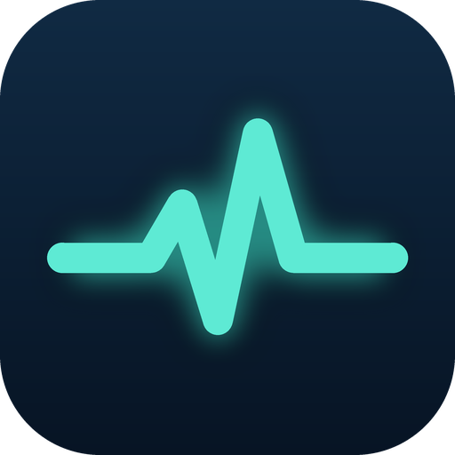

<p align="center"></p>

<h1 align="center">Garmin MCP</h1>

<p align="center">Talk to Claude about your training, sleep and recovery, with your own Garmin data behind it.</p>

<p align="center">
  <a href="https://github.com/bragenybakk/garmin-mcp/releases/latest/download/garmin-mcp.mcpb"></a>
</p>

<p align="center">Then open the downloaded file <strong>with Claude</strong> (right-click → Open with → Claude).<br>
Fill in your Garmin email and password, and ask: <em>"How did I sleep last night?"</em></p>

## Install

You need [Claude Desktop](https://claude.ai/download) and a Garmin Connect account.

1. Click **Download** above.
2. Open the downloaded file **with Claude**: right-click it in your Downloads folder and choose **Open with → Claude**. Claude Desktop opens the installer.
   - If it opens in another program (for example a zip tool), that's the wrong one: use **Open with → Claude** instead.
   - Or drag the file into Claude Desktop's **Settings → Extensions** page.
3. Fill in the email and password you use for Garmin Connect, and install.
4. Ask Claude: *"How did I sleep last night?"*

That's all. There is nothing else to install: Claude Desktop sets up what it needs the first time, so the very first answer takes a little longer.

- **Two-step verification on your Garmin account?** Claude asks you for the code Garmin sends, once.
- **Warning that the extension isn't verified?** Expected: the file isn't signed. You can read all the code in this repository.
- **Privacy:** your password stays in your computer's keychain, and your data goes straight between your computer and Garmin.

## What you can ask

I built it so I can ask Claude how to plan the next weeks of training, whether I'm recovering well, and what separates the nights I sleep well from the ones I don't. For example:

- *"How has my sleep been the last two weeks, and does it drop after hard sessions?"*
- *"Based on my last 10 runs, am I training too much at high intensity?"*
- *"My HRV is low today. Should I swap the interval session for an easy run?"*
- *"Compare my training load the last 8 weeks. Am I building up too fast?"*
- *"How did the intervals on Saturday go, lap by lap?"*

Claude can only read your data. It can't change anything in Garmin Connect.

<details>
<summary><strong>All 16 tools</strong></summary>

| Tool | What it returns |
|---|---|
| `get_recovery_snapshot` | Last night's sleep, HRV against baseline, training readiness, resting HR, body battery and stress in one call |
| `get_sleep_data` | Sleep for one night: stages, sleep score and its factors, HRV, SpO2, respiration |
| `get_sleep_last_n_days` | Sleep for the last N nights (up to 90), with averages |
| `get_hrv` | Overnight HRV with weekly average, status and personal baseline range |
| `get_daily_summary` | Steps, calories, intensity minutes, heart rate, stress and body battery for a day |
| `get_training_readiness` | Training readiness score and the factors behind it |
| `get_training_status` | Training status, acute vs chronic load, 4-week load balance, VO2 max |
| `get_recent_activities` | Latest workouts with pace/speed, heart rate zones, training load and training effect |
| `get_activities_by_date` | All workouts between two dates |
| `get_activity_details` | Laps/splits, heart rate zones, running dynamics and weather for one workout |
| `get_weekly_training_load` | Per week: sessions, hours, distance, load, intensity minutes, zones, sport mix |
| `get_planned_workouts` | Workouts scheduled in the Garmin calendar and active training plans |
| `get_performance_metrics` | VO2 max, race predictions, endurance score, hill score, fitness age, lactate threshold |
| `get_personal_records` | Personal records and the activities they were set in |
| `get_wellness_trend` | Day-by-day sleep, HRV, resting HR, readiness, body battery, stress, steps, intensity minutes, weight or VO2 max, with stats |
| `garmin_submit_mfa_code` | Finishes sign-in when Garmin asks for a verification code |

</details>

## Troubleshooting

- **The Garmin tools don't show up:** check that the extension is turned on under **Settings → Extensions** in Claude Desktop, then restart Claude Desktop.
- **Sign-in fails:** check the email and password in the extension's settings in Claude Desktop. If it still fails, delete the `.garminconnect` folder in your home folder and try again.
- **"Garmin is rate limiting requests":** wait a few minutes. Garmin blocks for a while after repeated failed sign-ins.
- **Used the older version of this project?** Remove the `"garmin"` entry from `claude_desktop_config.json` (Settings → Developer → Edit Config) so you don't get the tools twice.

## On your phone too?

The extension works in Claude Desktop on the computer it is installed on. I also run a hosted version for a few friends that works on claude.ai and in the Claude phone apps. Ask me if you'd like access.

---

## For developers

<details>
<summary><strong>How it works, running from source, building the bundle</strong></summary>

### How it works

- Built with the official [MCP Python SDK](https://github.com/modelcontextprotocol/python-sdk) (`MCPServer`) and [python-garminconnect](https://github.com/cyberjunky/python-garminconnect). Each tool is a plain Python function in [`server.py`](server.py) with a docstring the model reads to decide when to call it.
- Sign-in tokens are saved in `~/.garminconnect` and refreshed automatically, so the password is only used when there is no valid session.
- Garmin's raw responses are huge (one night of sleep is close to 200,000 characters). The tools return compact summaries instead and leave out GPS positions and profile details.
- It ships as an [MCP Bundle](https://github.com/modelcontextprotocol/mcpb) with `server.type = "uv"`: Claude Desktop installs Python and the locked dependencies itself.
- The same server can run on the internet for claude.ai and the phone apps, shared by invited people: see [docs/remote.md](docs/remote.md).

### Run from source

You need [uv](https://docs.astral.sh/uv/) (or Python 3.12+ with `pip install -r requirements.txt`).

```bash
git clone https://github.com/bragenybakk/garmin-mcp.git
cd garmin-mcp
cp .env.example .env    # fill in GARMIN_EMAIL and GARMIN_PASSWORD
uv run server.py
```

`.env` stays on your computer: it is in `.gitignore` and never goes into the bundle.

Try the tools with the MCP Inspector: `npx @modelcontextprotocol/inspector uv run --directory . server.py`

Use it from Claude Code: `claude mcp add garmin -- uv run --directory /full/path/to/garmin-mcp server.py`

### Build the bundle

Needs Node.js (for `npx`): `python scripts/build_mcpb.py`

This copies only the files the bundle needs into `build/bundle/`, validates `manifest.json`, packs `dist/garmin-mcp.mcpb` with the official mcpb CLI, and refuses to finish if anything like `.env` or a token file ended up inside. The version in `manifest.json`, `pyproject.toml` and `server.py` must match. Attach `dist/garmin-mcp.mcpb` to a GitHub release with that exact file name, so the download link above keeps pointing at the newest version.

After changing dependencies in `pyproject.toml`, run `uv lock` (with uv 0.9.7, the version Claude Desktop uses).

### Ideas for later

- Create and schedule workouts on the Garmin calendar (write access, behind a confirmation)
- Caching responses to avoid repeated calls to Garmin

</details>
